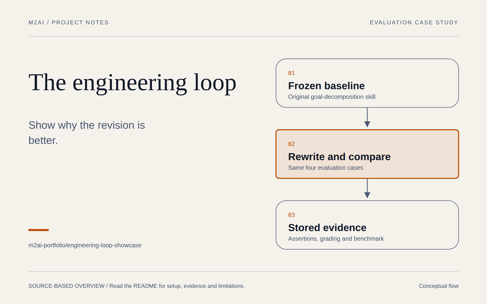

# Tear It Down and Rebuild It



A prompt can sound better and still produce the wrong output. This case study follows the rebuild of a goal-decomposition skill from an open-ended improvement request to a comparison with explicit assertions, recorded evidence, and a human acceptance gate.

The most useful finding was small: the old skill promised JSON but never specified its schema. In the recorded JSON-mode case, it passed 2 of 6 assertions. The rebuilt version passed all 6. The showcase lets you inspect the outputs and judgments behind that result.

**[Explore the case study](https://m2ai-portfolio.github.io/engineering-loop-showcase/)**

## What the recorded experiment found

| Metric | Old skill | Rebuilt skill |
|---|---:|---:|
| Mean assertion pass rate across four cases | 74.2% ± 28.6% | 100% ± 0% |
| Total assertions passed | 17 / 23 | 23 / 23 |
| Mean wall-clock time per run | 47.5 seconds | 47.4 seconds |
| Mean tokens per run | 76,645 | 77,553 |

These are results from the stored case study: four prompts, two skill versions, eight runs. The mean pass rate is an average of per-case rates, which differs from dividing total passed assertions by 23. This small evaluation does not establish a general success rate or predict production performance.

## The reusable workflow

1. Research how the skill is used and decide what the output contract must preserve.
2. Make consequential design choices with a human before changing the skill.
3. Freeze the old version so the comparison has a stable baseline.
4. Rebuild, then run both versions on the same four evaluation cases in fresh agent contexts.
5. Grade against explicit assertions and attach evidence to each verdict.
6. Compare outcomes, timing, and token use, then return the decision to a human reviewer.

The page includes side-by-side outputs, graded evidence, before-and-after excerpts, and five copyable prompt templates for adapting the pattern.

## Run the showcase locally

Requires Git and a modern browser. No Node.js installation, backend, or API key is needed to view the evidence.

```bash
git clone https://github.com/m2ai-portfolio/engineering-loop-showcase.git
cd engineering-loop-showcase
```

Open [index.html](index.html) in a browser. The page is self-contained.

## A five-minute review

1. Read the engineering-loop sequence to understand what changed and who approved it.
2. Inspect the JSON-mode evaluation, comparing the old output, rebuilt output, and each assertion.
3. Check the aggregate table against the individual cases.
4. Choose a prompt template and adapt its task, constraints, and acceptance criteria to your own skill.

Re-running the underlying agent experiment requires your own Claude Code environment and model access. The repository presents the captured evidence; opening the page does not launch an evaluation.

## Evidence and editing notes

All displayed paths, hostnames, and URLs in the evaluation examples are illustrative replacements. The original README describes the structure, scores, and grader verdicts as preserved from the evaluation workspace. Treat those as historical experiment records, not a new independent benchmark run.

To update the showcase, edit `index.html`, reopen it, and check navigation, copy buttons, evaluation panels, and narrow-screen layout. Keep the reported totals consistent with the individual assertions.

Built by Matthew Snow / [M2AI](https://memyselfplusai.com), using Claude Code's skill-creator methodology. No license file is included in this snapshot.
